# nov.dock: a macOS-style Floating Dock for Omarchy

**nov.dock** turns Omarchy's floating workspaces into a desktop that feels at home for anyone coming from macOS. It is a dock with a minimize animation, a Downloads stack, edge snapping that respects the dock, and a handful of fixes for things that get in the way on floating workspaces.

<p align="center">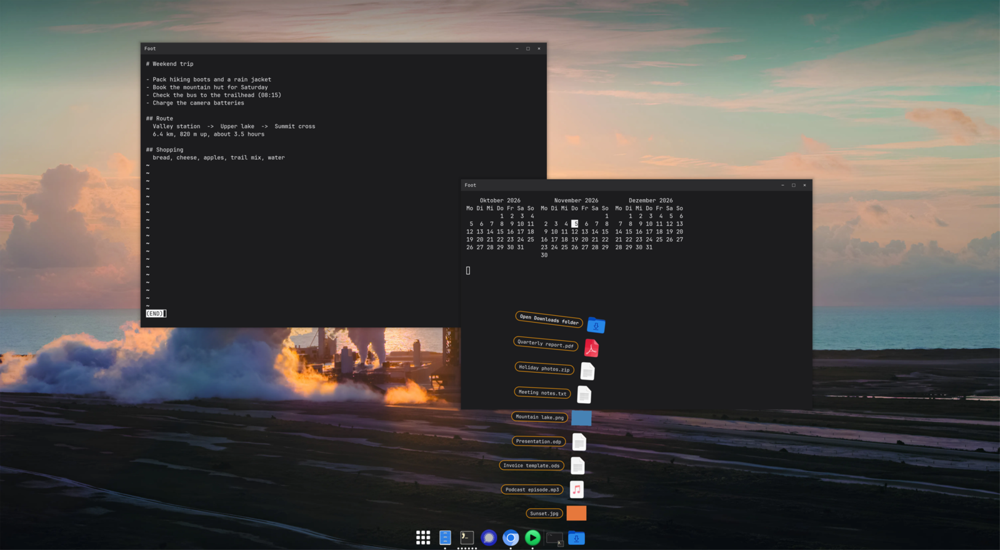</p>

It replaces Omarchy's built-in dock (it is a clone of `omarchy.dock`) and comes with a small native Hyprland plugin for the parts the shell cannot do on its own.

## Features

### The dock

Pinned and running apps sit side by side, with a dot for every open window. The app grid button opens all apps, and the Downloads stack sits at the end.

<p align="center">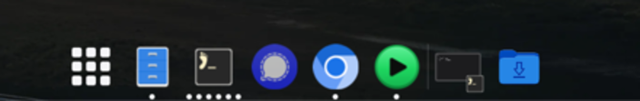</p>

- **Pin apps** by dragging them from the app grid onto the dock, or with a right-click → *Keep in Dock*. Pins are kept in `~/.config/omarchy/shell.json` and survive restarts.
- **Reorder** by dragging icons along the dock.
- **Super + click** on an app icon opens a new window of that app, as Cmd + N does on macOS.

<p align="center">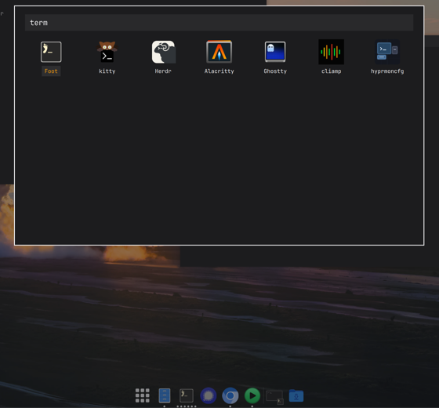 &nbsp; 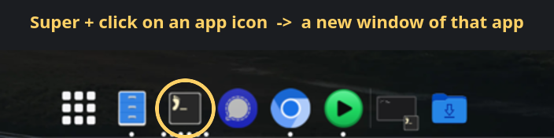</p>

### Minimize into the dock (genie effect)

Minimizing a window pours it into the dock in a funnel, like macOS's genie effect: the window bends into a smooth funnel and slides down it into its slot, drawn on the GPU as one continuously curved surface. The window waits there as a snapshot with its app's icon, between the apps and the Downloads stack. A click brings it back out the same way, to exactly where it was.

This works for every way of minimizing: the titlebar button, Super + M and the dock menu.

<p align="center">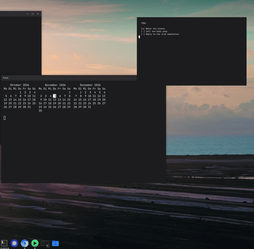 &nbsp; 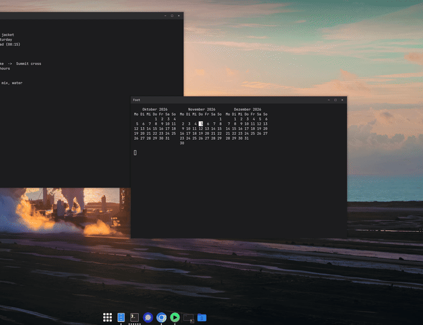<br><sub>Minimize and restore, shown in slow motion</sub></p>

### Downloads stack

Click the Downloads folder and your latest downloads fan out above it, the newest right above the stack, just like on macOS.

- Images show a thumbnail.
- A click opens a file straight in its default app, as a double-click in the file browser does. Text files open in your default editor (nvim on a stock Omarchy).
- The top step opens the Downloads folder, and so does a right-click on the stack.

<p align="center">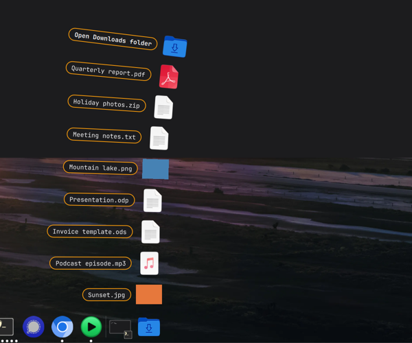</p>

### Snapping that keeps the dock visible

- Drag a window to the **left or right edge** and it fills that half of the screen, stopping just above the dock.
- Drag it to the **top edge** and it is maximized (not fullscreen): the bar stays, and the dock steps aside until you need it.

The same works from the keyboard, but only while a window on a floating workspace has focus, so apps elsewhere keep these keys:

| Keys | Action |
|---|---|
| Alt + ← / → | Snap to the left / right half |
| Alt + ↑ | Maximize |
| Alt + ↓ | Restore the previous position and size |

<p align="center">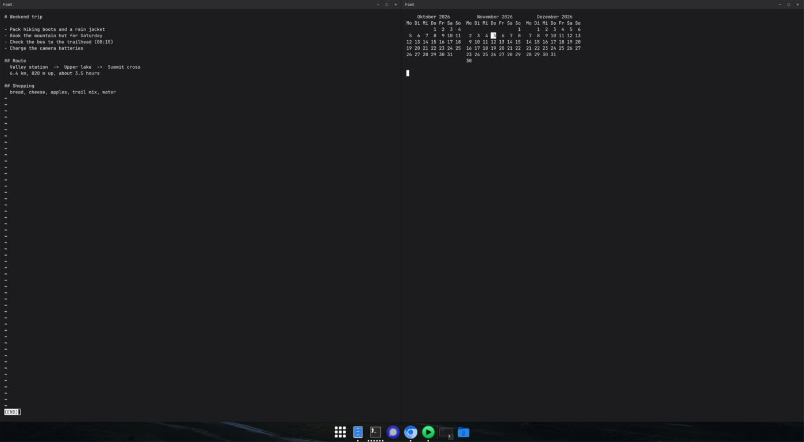 &nbsp; 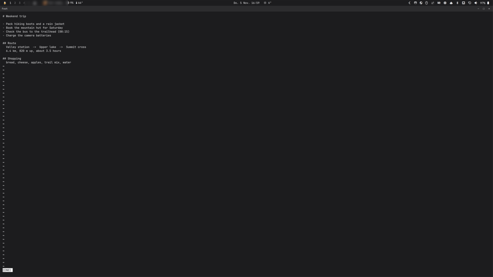</p>

### Scroll the window under the pointer

As on macOS, you can scroll any window just by pointing at it. Keyboard focus stays where it was, so typing still goes to the focused window, and a click moves focus as usual. This applies to floating workspaces only; tiled workspaces keep their own focus setting.

<p align="center">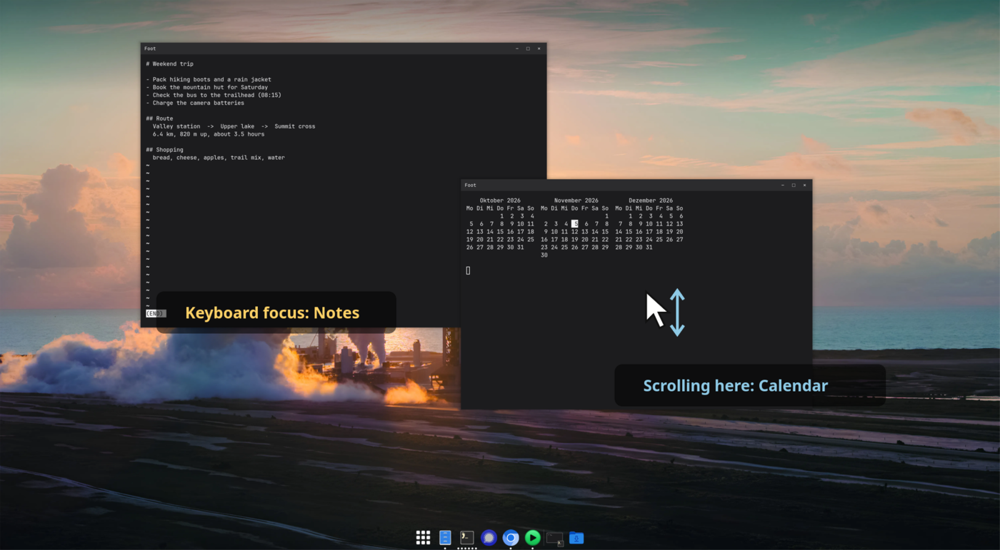</p>

### See where Alt + Tab went

On floating workspaces, the window Alt + Tab (or Alt + Shift + Tab) lands on glows briefly: a soft frame in your theme's accent color settles onto its edge, titlebar included, and fades away. Among overlapping windows you can see at a glance where focus went. Omarchy's own window switching is left as it is; the glow is added next to it. It is on by default and can be switched off in the bar menu (*Focus glow*).

### Window borders, on or off, for all windows

A small window icon in the bar opens a switch that turns window borders on or off for every window on floating workspaces, including windows you open later. A new window has no border from its very first frame.

<p align="center">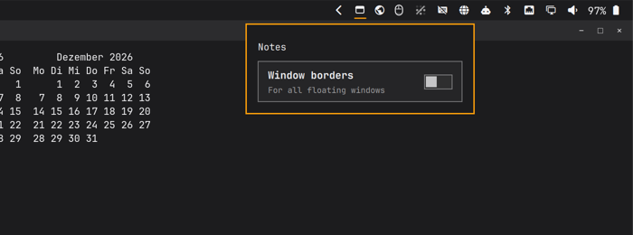 &nbsp; 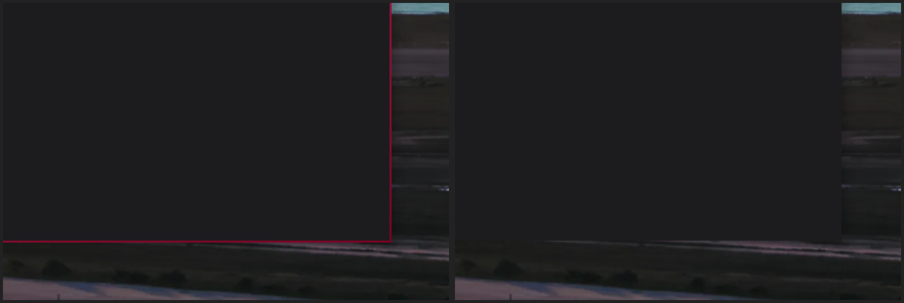</p>

## Fixes

nov.dock also works around a few problems you run into on floating workspaces:

- **Maximized windows stay behind after Alt + Tab.** Normally, a window focused over a maximized one keeps being drawn on top of it. With nov.dock, when Alt + Tab (or a click) brings a maximized window back, it is in front again.

  <p align="center">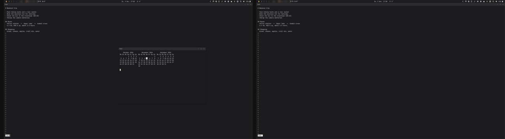</p>

- **Screensaver with two monitors.** Hyprland 0.56 can fade the bar back in on the second monitor, over the fullscreen screensaver. nov.dock keeps the bar and the dock hidden under it on every monitor.

  <p align="center">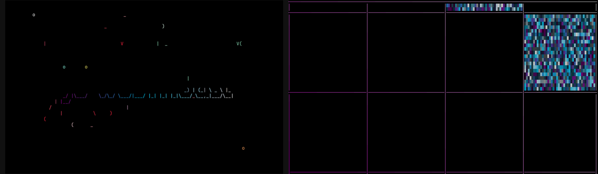</p>

- **Pins that disappeared.** A user plugin cannot read the shell's own config, so a naive dock sees no pins and overwrites them when you pin the next app. nov.dock reads and follows `shell.json` itself.
- **Focus-on-click after switching monitors.** Omarchy's floating mode can be left with the tiled focus setting after focus moves between monitors. nov.dock decides the focus mode from the workspace's saved layout instead.

## Install

Requirements:

- Omarchy 4.5 or newer with Hyprland 0.56
- The tools to build the native plugin: `base-devel`, `pkgconf` and the Hyprland headers, which ship with the `hyprland` package
- `python3` with PyGObject (`python-gobject`), `jq` and `gio`, all present on a stock Omarchy

```bash
omarchy plugin add https://github.com/jwm3000/nov.dock --yes
~/.config/omarchy/plugins/nov.dock/install.sh
```

`install.sh` does the following:

1. Builds the native snap plugin for your Hyprland version.
2. Links `hypr/nov-floating-dock.lua` to `~/.config/hypr/nov-floating-dock.lua`.
3. Asks before adding one line, `require("hypr.nov-floating-dock")`, to your `~/.config/hypr/hyprland.lua`. It keeps a backup next to the file. Pass `--yes` to skip the question.
4. Enables the plugin (which replaces the built-in dock) and restarts the shell.

## Update

```bash
omarchy plugin update nov.dock
~/.config/omarchy/plugins/nov.dock/install.sh
```

Run `install.sh` again after every Hyprland update too: the native plugin only loads into the Hyprland version it was built for.

## Remove

```bash
~/.config/omarchy/plugins/nov.dock/uninstall.sh
omarchy plugin remove nov.dock
```

`uninstall.sh` does the following:

- Unloads the native plugin.
- Removes the hook link.
- Asks before removing the `require` line from `hyprland.lua`, keeping a backup.

The built-in Omarchy dock comes back once nov.dock is removed. The only state nov.dock keeps is `~/.local/state/nov-dock/` (the borderless and focus glow switches), which you can delete.

## How it is built

| Path | What |
|---|---|
| `manifest.json`, `*.qml`, `DockModel.js`, `i18n/` | The shell plugin (dock, app grid, Downloads stack, bar widget, `GenieOverlay.qml` for the minimize animation, `FocusGlow.qml` for the Alt + Tab glow) |
| `shaders/` | The genie effect's vertex and fragment shaders, with the compiled `.qsb` files the dock loads. `build.sh` recompiles them with Qt's `qsb`; only needed after editing them |
| `desktop.py` | Helper for window state, borders, downloads and new windows |
| `native/` | The Hyprland plugin (C++): edge snapping, Super + click on the dock, the Alt + Tab and screensaver fixes. Build with `make`, test with `make test` |
| `hypr/nov-floating-dock.lua` | Loads the native plugin, sets up Alt + arrow keys, the Alt + Tab glow, the border rule and scrolling under the pointer |
| `tests/` | `python3 -m unittest tests/test_desktop.py`, plus live smoke and visual tests |

German and English translations are included.

## License

MIT, see [LICENSE](LICENSE). The native snap plugin builds on [omarchy-windows-snap](native/LICENSE.snap) by rawritude (MIT).
